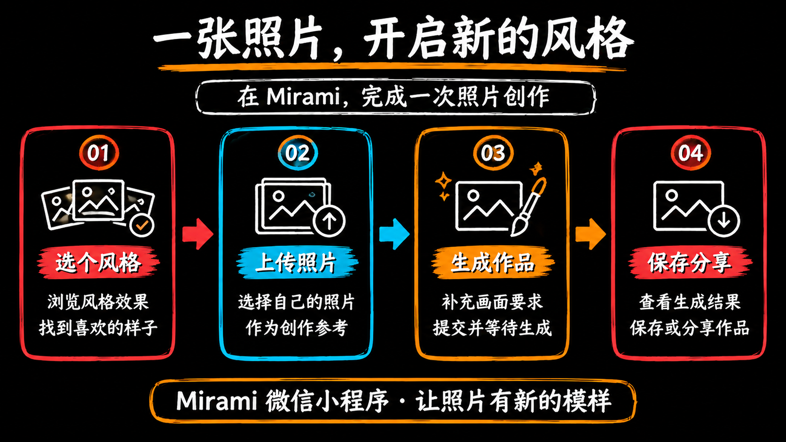

# Region Motion

Turn the contents of an image into an animation, one region at a time.

Upload an image, detect regions automatically, refine their boundaries, arrange their order, preview the animation, and export an MP4 or GIF. The local version sends images only to the service on your own computer. The hosted version sends images to the deployed server for region detection and export. Neither version requires an AI key. You can also install this repository as a Codex skill and open the local workspace with `$region-motion`.

- Hosted app: [https://www.jhstore.cn/region-motion/](https://www.jhstore.cn/region-motion/)
- Mirami workbench: [https://www.jhstore.cn/pc/workbench/studio/](https://www.jhstore.cn/pc/workbench/studio/)

## Exported demo


An exported GIF at 1920 × 1080, 15 fps, and 12.4 seconds. [Download the original GIF](docs/examples/region-motion-demo.gif).

## Run locally

Requirements:

- Python 3.11 or later.
- Node.js 22 or later and npm.
- FFmpeg on your `PATH`, or set `FFMPEG_PATH` to its executable. FFmpeg is required for MP4 and GIF export.

Clone the repository and start the app:

```sh
git clone https://github.com/XiesRay/region-motion.git
cd region-motion
python3 scripts/start.py
```

On first run, the startup script installs npm dependencies, builds the frontend, and prepares OpenCV. It reuses a compatible Python environment if available; otherwise, it installs `scripts/requirements.txt` into `.venv` in this repository. Initial setup requires network access. After setup, local image processing and export work offline.

The app opens at:

```text
http://127.0.0.1:4317
```

To open the URL yourself, use `python3 scripts/start.py --no-open`. If the port is occupied, choose another port, for example `python3 scripts/start.py --port 4318`.

## Try the two-image examples

In the app, choose **Load two-image demo**. Both images are added and detected automatically without downloading them first. Existing work in the project is preserved.

### Example 1: Mirami feature overview


This image contains a title, four feature cards, and a footer note. Practice selecting each part separately and arranging them in presentation order. Drag items in the region list if automatic detection does not match the order you want.

### Example 2: A photo, a new style



Use this image to practice arranging a four-step flow: choose a style → upload a photo → generate an image → save and share. Adjust the order of the cards, text, and arrows, preview the sequence, then export an animated GIF or MP4.

Select an image thumbnail on the left to switch the active canvas. The **Instructions** button in the upper-right corner also contains steps and example previews.

## Editing workflow

1. **Upload images:** Select PNG, JPEG, or WebP files with the upload button. You can select multiple images; each becomes a scene and is detected after upload.
2. **Adjust boundaries:** Select a region on the right, then drag the blue handles on the canvas. Rectangle edges can be adjusted independently. Dragging a freeform edge moves both of its endpoints.
3. **Add or move regions:** Use **Rectangle Select** or **Freeform Select** to add regions. Use **Select / Move** to move a whole region. **Hide Region** covers content that should not appear.
4. **Arrange the sequence:** Drag a region row up or down in the right-hand list and release at the insertion line. You do not need to select the region or target its handle. The up and down arrows are also available. Locked regions cannot be dragged. The automatically generated **Full Image Last** region stays at the end; newly added regions are placed before it.
5. **Set animation:** Choose instant, fade, pop, slide, or wipe. Adjust the start time, duration, and wipe direction. **Auto Schedule** recalculates timing in the current list order.
6. **Preview:** Click **Play** below the canvas or press Space to pause or resume. Drag the progress bar to seek, and press Esc to return to editing. At 100% zoom the canvas fits the available area; when zoomed in, scrolling stays inside the canvas.
7. **Export:** Choose MP4 or GIF in the upper-right corner and click **Export**. The button shows progress and the browser downloads the finished file automatically. Use **Download Again** only when you want another copy. The save location is controlled by your browser.
8. **Save your project:** Click **Save Project** to download a JSON file. Later, use **Open Project** to restore the images, regions, animations, and scene order. MP4 and GIF files do not contain the editing data needed to continue a project.

Edits can be undone, including deleting or clearing regions. Shortcuts: Space to play or pause, Esc to return to editing, Delete or Backspace to remove the selected region, ⌘/Ctrl+Z to undo, and ⌘/Ctrl+Shift+Z to redo. Editing shortcuts are disabled while typing in an input field.

## Export formats

Both formats use a fixed long edge of **1920 px**. There is no resolution selector. The aspect ratio follows the first image in the project; other images are scaled proportionally and centered with letterboxing.

| Format | Output | Good for |
| --- | --- | --- |
| MP4 | H.264, 30 fps, no audio track | Video sharing, presentations, or further editing |
| GIF | 15 fps, loops continuously | Chats, documents, and web pages |

Both formats include region animations and scene transitions. Choosing the light workspace theme does not change the source image or exported background. Each project can contain up to 30 images and 100 regions per image. Each image is limited to 20 MB and 40 megapixels; project JSON is limited to 80 MB; each export can be up to 10 minutes. Export creates standard PNG copies, which must also fit within the image limits.

## Automatic region detection

Detection uses OpenCV through `scripts/opencv_object_boxer.py`, extracted from the original project, with a default filter threshold of 2. It is image processing, not AI image recognition, and does not require an AI key.

Whiteboard images and illustrations with uniform backgrounds and separated elements tend to work best. For photos, gradients, or overlapping elements, adjust the detected results manually. Leave **Target Content Region Count** empty to let detection estimate a count, or enter a desired count and run detection again. This value is a hint; it does not guarantee an exact number of regions.

**Redetect Regions** replaces the regions for the current image. **Clear Regions** removes all regions from that image. Both actions can be undone. **Full Image Last** can reveal content that was not selected individually.

## Local and hosted data handling

In the local version, the browser sends images to the service on `127.0.0.1` on your computer for detection and export. Images and edits remain in the current browser page unless you save a project JSON file. There is no cloud sync.

In the hosted version, region detection and export send the relevant images from your browser to the deployed server. The server processes them and returns the results. No AI key is required. Save the project JSON manually if you need to preserve or move your editable project; the hosted app does not provide cloud project sync.

Export results are temporarily stored under `assets/app/.runtime/exports/`. Intermediate files are removed after a task completes, while the finished output is retained. The task list does not survive a service restart. Downloaded exports and project JSON files are unaffected. Do not include `.runtime/`, `.venv/`, or `node_modules/` in source distributions.

## Server deployment

The hosted app is served at [https://www.jhstore.cn/region-motion/](https://www.jhstore.cn/region-motion/). The deployment uses Docker for the app and Nginx as a reverse proxy. Nginx forwards requests to the app at `127.0.0.1:4317` and serves it under `/region-motion/`.

From this Mac, run the repository deployment script:

```sh
scripts/deploy.sh
```

The script builds the frontend locally, uploads the build with the server sources, and limits Docker build resources on the server. It reuses the existing Mirami SSH configuration script on this Mac for its connection settings. Credentials are not included in this repository or README. Do not copy connection credentials into project files.

## Install as a Codex skill

Place this directory at `~/.codex/skills/region-motion`, or link that path to this directory. Reopen the Codex session, then say:

```text
Use $region-motion to open the local image animation workspace.
```

The [SKILL.md](SKILL.md) entry point launches the same local app.

## Stop and develop

Stop the local service:

```sh
python3 scripts/stop.py
```

From `assets/app`, you can run type checking and build the frontend:

```sh
npm run typecheck
npm run build
```

After frontend changes, rebuild and refresh the page. After changing the local service, stop it and start it again. The repository includes source files for pure-function tests; their presence does not mean that the tests have passed. This README does not claim complete interaction or end-to-end verification, including export verification.

## License

The code, documentation, and included examples are available under the [MIT License](LICENSE). Third-party dependencies have their own licenses. Node.js, Python, and FFmpeg are not bundled with the source.
