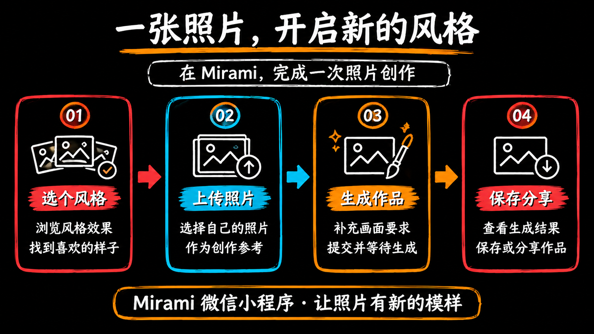

# Region Motion

**[English](README.md)** | 简体中文

### [在线体验 Region Motion →](https://www.jhstore.cn/region-motion/)

无需安装，也不需要 AI Key。[Mirami 工作台](https://www.jhstore.cn/pc/workbench/studio/) · [与任意 AI Agent 配合使用](#与任意-ai-agent-配合使用)

把一张图片中的内容，按顺序变成动画。

上传图片后，工具会自动识别区域；你可以调整边界、安排出现顺序、预览动画，最后导出 MP4 或 GIF。本地版只会把图片发送给你自己电脑上的服务。在线版会将图片发送到部署服务器进行区域识别和导出。两种版本都不需要 AI Key。你可以独立运行应用，也可以让具备文件读取和 Shell 操作能力的 AI Agent 使用同一入口启动。支持读取 `SKILL.md` 的 Agent 也可以将它作为 Skill 加载。

## 导出的动画示例


这是一个分辨率为 1920 × 1080、15 fps、时长 12.4 秒的导出 GIF。[下载原始 GIF](docs/examples/region-motion-demo.gif)。

## 本地运行

本地启动支持 macOS 和 Linux。运行环境：

- Python 3.11 或更高版本。
- Node.js 22 或更高版本及 npm。
- FFmpeg。可将其加入 `PATH`，或通过 `FFMPEG_PATH` 指定可执行文件。导出 MP4 和 GIF 都需要 FFmpeg。

克隆仓库并启动应用：

```sh
git clone https://github.com/XiesRay/region-motion.git
cd region-motion
python3 scripts/start.py
```

首次启动时，脚本会安装 npm 依赖、构建前端并准备 OpenCV。如果找到兼容的 Python 环境，脚本会直接复用；否则会在仓库的 `.venv` 环境中安装 `scripts/requirements.txt`。首次准备依赖需要联网；完成后，本地图片处理和导出可以离线运行。

应用会打开：

```text
http://127.0.0.1:4317
```

如果想自行打开浏览器，可运行 `python3 scripts/start.py --no-open`。端口被占用时，可以指定其他端口，例如 `python3 scripts/start.py --port 4318`。

## 试用双图案例

打开应用后，点击 **载入双图案例演示**。两张图片会自动加入项目并进行区域识别，无需先下载；已有项目内容会保留。

### 案例一：Mirami 功能介绍


图片包含标题、四张功能卡片和底部说明。可以练习分别框选每个部分，再按讲解顺序排列。如果自动识别结果不符合预期，可以直接拖动区域列表中的项目调整顺序。

### 案例二：一张照片，开启新的风格



这张图适合练习排列四步流程：选择风格 → 上传照片 → 生成图片 → 保存并分享。调整卡片、文字和箭头的出现顺序，预览动画后导出 GIF 或 MP4。

点击左侧图片缩略图可以切换当前画面。右上角的 **使用说明** 按钮也包含操作步骤和案例预览。

## 编辑流程

1. **上传图片：** 点击上传按钮选择 PNG、JPEG 或 WebP 文件。可以一次选择多张图片；每张图片会成为一个画面，并在上传后自动识别区域。
2. **调整边界：** 在右侧选中一个区域，再拖动画布上的蓝色控制点。矩形的四条边可以分别调整；拖动自由选区的一条边时，该边的两个端点会一起移动。
3. **添加或移动区域：** 使用 **矩形框选** 或 **自由圈选** 添加区域。使用 **选择 / 移动** 可移动整个区域。**隐藏区域** 可以遮住不希望显示的内容。
4. **排列出现顺序：** 按住右侧区域列表中的一行，上下拖动到插入线位置后松开。无需先选中区域，也不必对准手柄；也可以使用上下箭头调整。锁定的区域不能拖动。自动生成的 **整图末位** 区域固定在最后；新添加的区域会放在它前面。
5. **设置动画：** 选择直接出现、淡入、轻弹、滑入或擦除动画。可以调整开始时间、持续时间和擦除方向。**自动排时** 会按当前列表顺序重新安排时间。
6. **预览：** 点击画布下方的 **播放**，或按空格键暂停／继续。拖动进度条可定位；按 Esc 返回编辑。缩放为 100% 时，画布会适配可用区域；放大后，滚动仅发生在画布内。
7. **导出：** 在右上角选择 MP4 或 GIF，再点击 **导出**。按钮会显示导出进度，完成后浏览器会自动下载文件。只有需要再次获取文件时才点击 **重新下载**。文件保存位置由浏览器设置决定。
8. **保存项目：** 点击 **保存项目** 下载 JSON 文件。之后可使用 **打开项目** 恢复图片、区域、动画和画面顺序。MP4 和 GIF 成品不包含继续编辑所需的项目数据。

删除或清空区域等修改都可以撤销。快捷键：空格键播放或暂停，Esc 返回编辑，Delete 或 Backspace 删除选中区域，⌘/Ctrl+Z 撤销，⌘/Ctrl+Shift+Z 重做。在输入框中输入时不会触发编辑快捷键。

## 导出格式

两种格式的输出长边均固定为 **1920 px**，没有分辨率选项。画幅比例跟随项目中的第一张图片；其他图片会等比缩放并居中留边。

| 格式 | 输出 | 适用场景 |
| --- | --- | --- |
| MP4 | H.264、30 fps、无音轨 | 分享视频、演示或后续剪辑 |
| GIF | 15 fps、循环播放 | 聊天、文档和网页 |

两种格式都会保留区域动画和场景转场。切换工作台浅色主题不会改变源图片或导出画面的背景。每个项目最多包含 30 张图片，每张图片最多 100 个区域。单张图片不超过 20 MB 和 4000 万像素；项目 JSON 不超过 80 MB；单次导出最长 10 分钟。导出时会生成标准 PNG 副本，这些副本也必须符合图片限制。

## 自动识别区域

区域识别通过 `scripts/opencv_object_boxer.py` 调用 OpenCV，该脚本从原项目中提取而来，默认过滤阈值为 2。它属于图像处理，不是 AI 图像识别，因此不需要 AI Key。

背景颜色统一、元素之间有间隔的白板图和插画通常更容易识别。照片、渐变背景或元素重叠时，建议手动调整识别结果。**目标内容区域数** 留空时会自动估算；也可以填写期望数量后重新识别。这个数量仅作提示，不保证最终区域数完全一致。

**重新自动框选** 会替换当前图片的区域；**清空框选** 会移除当前图片的全部区域。这两项操作都可以撤销。**整图末位** 会在最后显示尚未单独框选的内容。

## 本地版与在线版的数据处理

本地版中，浏览器会把图片发送给你电脑上 `127.0.0.1` 的服务进行区域识别和导出。除非你手动保存项目 JSON，图片和编辑内容只保留在当前浏览器页面中；工具不提供云同步。

在线版中，区域识别和导出所需的图片会从浏览器发送到部署服务器处理，处理结果再返回浏览器。不需要 AI Key。如需保留或迁移可继续编辑的项目，请手动保存项目 JSON；在线版不提供云端项目同步。

导出结果会暂存在 `assets/app/.runtime/exports/`。任务完成后，中间文件会被清理，成品会保留。服务重启后任务列表不会恢复；已下载的成品和项目 JSON 不受影响。分发源码时不要包含 `.runtime/`、`.venv/` 或 `node_modules/`。

## 部署到服务器

在线应用地址为 [https://www.jhstore.cn/region-motion/](https://www.jhstore.cn/region-motion/)。应用通过 Docker 运行，Nginx 作为反向代理，将请求转发到 `127.0.0.1:4317`，并通过 `/region-motion/` 路径对外提供服务。

在这台 Mac 上，从仓库目录运行部署脚本：

```sh
scripts/deploy.sh
```

脚本会在本地构建前端，将构建结果与服务端源码一同上传，并限制服务器上的 Docker 构建资源。连接设置复用这台 Mac 上现有的 Mirami SSH 配置脚本。仓库和本文档不包含登录凭据；不要把连接凭据复制到项目文件中。

## 与任意 AI Agent 配合使用

Region Motion 不依赖特定 Agent SDK、厂商 API 或专属启动命令。具备文件读取和 Shell 操作能力的 Agent 都可以通过同一个 Python 入口启动应用。浏览器控制是可选的；Agent 可以在健康检查通过后把本地地址发给你自行打开。

### 为你的 Agent 安装

使用 Node.js 22.20 或更新版本，通过 [Skills CLI](https://github.com/vercel-labs/skills#install-a-skill) 安装：

```sh
npx skills add XiesRay/region-motion
```

根据提示选择目标 Agent。安装器覆盖其[官方支持列表](https://github.com/vercel-labs/skills/blob/main/docs/agents.md)中的工具；列表之外的 Agent，可使用下方的直接启动方式。

### 从任意仓库副本启动

将下面的绝对路径替换为你克隆仓库的位置，然后把提示词发给 Agent：

```text
阅读 /绝对路径/region-motion/SKILL.md。
运行 python3 /绝对路径/region-motion/scripts/start.py --no-open。
健康检查通过后返回访问地址；如果有浏览器工具，也可以直接打开页面。
```

支持 Skill 发现功能的 Agent，可将整个仓库放入其说明文档指定的 Skill 目录，并命名为 `region-motion`，然后让它打开 Region Motion。不支持 Skill 发现的 Agent，可以直接让它读取仓库中的 `SKILL.md`，或运行上面的命令。通用启动流程不需要特殊的 `$region-motion` 调用方式。

请将 `SKILL.md`、`scripts/` 和 `assets/` 保存在同一仓库目录中，以确保相对路径有效。可选的 `agents/openai.yaml` 为能识别该文件的工具提供界面元数据，其他 Agent 可以忽略。本地运行环境要求见[本地运行](#本地运行)。你也可以直接在浏览器中打开[在线体验](https://www.jhstore.cn/region-motion/)，无需安装 Agent。

## 停止与开发

停止本地服务：

```sh
python3 scripts/stop.py
```

在 `assets/app` 目录中，可以运行类型检查并构建前端：

```sh
npm run typecheck
npm run build
```

修改前端后，请重新构建并刷新页面。修改本地服务后，请先停止服务，再重新启动。仓库中包含纯函数测试源码；源码存在不代表测试已经通过。本文档不声称已完成完整交互或端到端验证，包括导出验证。

## 许可证

代码、文档和随附案例采用 [MIT License](LICENSE)。第三方依赖遵循各自的许可证。源码包不包含 Node.js、Python 或 FFmpeg。
